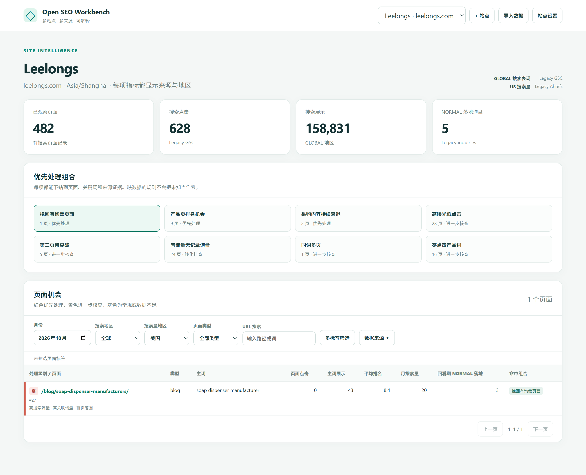

# Open SEO Workbench

一个在本机运行的多站点 SEO 数据看板。把页面、搜索词、搜索表现、关键词需求和询盘关联起来，按页面找出值得优先处理的机会。可以只导入表格使用；GSC、Ahrefs 或其他平台的 API 都不是必需条件。



> 界面示例。看板数字取决于所选站点、月份、地区及数据来源。

## 安装与启动

需要 **Python 3.11 或更高版本**、**Node.js 和 npm**，以及 Git。首次启动会安装 Python 依赖、安装前端依赖并构建页面，因此需要联网；之后使用已有依赖即可。

Windows PowerShell：

```powershell
git clone https://github.com/ethanzhou22455663/open-seo-workbench.git
cd open-seo-workbench
.\start.ps1
```

macOS / Linux：

```sh
git clone https://github.com/ethanzhou22455663/open-seo-workbench.git
cd open-seo-workbench
sh ./start.sh
```

启动后打开 [http://127.0.0.1:8766/](http://127.0.0.1:8766/)。需要查看或调用 REST 接口时，访问 [http://127.0.0.1:8766/docs](http://127.0.0.1:8766/docs)。服务默认只监听本机。

## 五分钟建立第一个站点

1. 点击右上角 **「+ 站点」**，填写站点名称、主域名和时区。每个站点有独立数据库；右上角可切换站点。
2. 打开 **「站点设置」**，填写页面路径分类规则。产品页、分类页、Blog 的判断会用到页面类型。还可以修改采购意图词、产品页排除的资讯词，以及标签和机会判断的数字门槛。
3. 点击 **「导入数据」**，先导入同一月份的「页面搜索表现」和「词 × 页面搜索表现」。这两份数据就能显示每页点击、展示、可见关键词及各词在该页的平均排名。
4. 如有关键词搜索量，导入「关键词搜索量」，并选对美国或全球地区；如有询盘记录，再导入「询盘」。缺少这些来源时，已有的搜索表现仍能查看。
5. 在页面机会表选择月份、地区和页面类型，点击页面查看其关键词明细及询盘月度记录。

### 准备导入文件

支持 CSV、TSV、XLSX 和 JSON。CSV 建议使用 UTF-8 编码。导入时选择数据类型、来源名称、地区、时间粒度和覆盖方式；原表列名不一致时，在 **「列名映射 JSON」** 中指定对应关系。先点 **「预览列」** 核对，再导入。

| 数据类型 | 至少需要的列 | 常用可选列 |
| --- | --- | --- |
| 页面搜索表现 `search_page` | `page_url`、`period`；`clicks`、`impressions`、`position` 中至少一项 | `page_type`、`language` |
| 词 × 页面搜索表现 `search_page_keyword` | `page_url`、`keyword`、`period`；至少一项搜索指标 | `clicks`、`impressions`、`position` |
| 关键词搜索量 `keyword_demand` | `keyword`、`period` | `volume`、`difficulty`、`cpc` |
| 询盘 `inquiry` | 一条询盘记录 | `external_id`、`submitted_on`、`landing_url`、`submit_url`、`quality`、`attribution` |
| 自定义指标 `custom_metric` | 已注册的 `metric_key`、实体 URL 或关键词、`period` | `value`、`value_text`、`entity_scope` |

例如，页面搜索表现和页面关键词表现可以分别保存为：

```csv
page_url,period,clicks,impressions,position,page_type
https://example.com/product/shower/,2026-10,12,600,8.4,product
```

```csv
page_url,keyword,period,clicks,impressions,position
https://example.com/product/shower/,shower supplier,2026-10,4,120,6.8
```

`period` 按月填写 `YYYY-MM`，按日填写 `YYYY-MM-DD`；也可以在导入界面提供默认月份。按日导入的搜索数据会在月度视图中汇总；同一页或同一页 × 词已有明确的月度记录时，以月度记录为准。`page` 和 `query` 可分别作为 `page_url` 和 `keyword` 的列名别名。含 `page` 或 `query,page` 维度的 GSC JSON 响应也可导入，但跨月响应必须先拆成逐月文件。

询盘按 **落地页** 和 **提交页** 分别关联。仅 `quality=NORMAL` 的记录进入看板的 NORMAL 询盘统计；这代表记录质量标签，**不等于已证明来自自然搜索**。如需修正已导入询盘，请保留稳定的 `external_id` 再次导入。

默认的 **「追加 / 更新」** 会更新同来源、同地区、同时间的数据；**「完整范围替换」** 会替换文件覆盖的时间范围。完全相同的文件重复导入不会重复计数。完整替换询盘时，每行必须提供 `submitted_on`。

## 读懂看板

- **顶部汇总**：所选月份的有搜索记录页面数、搜索点击、搜索展示和 NORMAL 落地询盘。展示指 Google 搜索结果展示，点击指搜索结果带来的点击。
- **优先处理组合**：按数据条件筛出询盘页回升机会、产品页排名机会、采购内容衰退、低 CTR、第二页关键词等。点击组合可直接筛选页面。
- **页面机会表**：每页一行，显示页面类型、主词、页面点击、主词展示、该词在该页的平均排名、搜索量及回看期询盘。红色表示优先处理，黄色表示进一步核查，灰色表示常规或证据不足。
- **页面详情**：默认列出按点击和展示排序的前十个可见词，可翻页看全部词。每个词的点击、展示、CTR、平均排名和上月变化都只对应这个页面；同一个词落在不同页面时不会混成一个排名。
- **多标签筛选**：同一标签组内满足任一项，跨组需同时满足。数字标准可在站点设置中修改。
- **地区与来源**：搜索表现地区和搜索量地区分别选择。可指定来源并保存来源偏好；系统不会把不同平台的点击直接相加。

Google Search Console 不会公开所有查询词。页面总点击与可见词点击的差额单独显示，不能反推出隐藏词。平均排名是所选时间段内的平均位置，不是某次搜索的固定名次。当月尚未结束时，系统仍显示现有数据，但暂停月环比趋势和下降类机会判断。缺失数据会显示为未知，不会被当作实际的零。

## 数据放在哪里

默认数据库位于用户应用数据目录：Windows 使用 `%LOCALAPPDATA%\open-seo-workbench`，macOS / Linux 使用 `$XDG_DATA_HOME/open-seo-workbench` 或用户目录下的 `.local/share/open-seo-workbench`。可通过环境变量 `SEO_PLATFORM_DATA_DIR` 指定私有数据目录。

Windows 示例：

```powershell
$env:SEO_PLATFORM_DATA_DIR = 'D:\seo-data'
.\start.ps1
```

站点数据库、上传文件、导出文件和密钥不应提交到 Git。仓库的 `.gitignore` 已排除常见本地数据文件。请不要把运行中的 SQLite 数据库放在网络共享目录上。

## 让 AI 读取看板：MCP

安装并启动过项目后，MCP 客户端可用以下命令通过 stdio 连接。`command` 请换成自己电脑上虚拟环境中 `seo-workbench` 可执行文件的**绝对路径**，并让 `SEO_PLATFORM_DATA_DIR` 指向看板使用的同一数据目录。

```json
{
  "mcpServers": {
    "seo-workbench": {
      "command": "C:\\path\\open-seo-workbench\\.venv\\Scripts\\seo-workbench.exe",
      "args": ["mcp"],
      "env": {"SEO_PLATFORM_DATA_DIR": "D:\\seo-data"}
    }
  }
}
```

macOS / Linux 的可执行文件位于 `.venv/bin/seo-workbench`。MCP 提供站点列表、页面与关键词详情、机会和依据、指标时间序列、导入状态等工具；站点操作都要求明确的 `site_id`。写入类工具默认先做 `dry_run`。本机 HTTP 客户端也可运行 `seo-workbench mcp --transport streamable-http --port 8767`，连接 `http://127.0.0.1:8767/mcp`。

## 接入其他数据来源

直接导入表格不需要任何 API 密钥。需要自动更新时，可以按 [数据来源适配器说明](docs/ADAPTERS.md) 安装独立的 GSC、Ahrefs、分析平台或 CRM 适配器。适配器将数据转换为相同的页面、关键词、地区和时间记录；看板和 MCP 无需绑定某一家供应商。额外指标可先通过 REST API 注册，再导入 `custom_metric` 数据。

开发者可运行 `python -m unittest discover -s tests -v` 检查后端，运行 `cd frontend && npm ci && npm run build` 检查前端。项目采用 [MIT License](LICENSE)。
